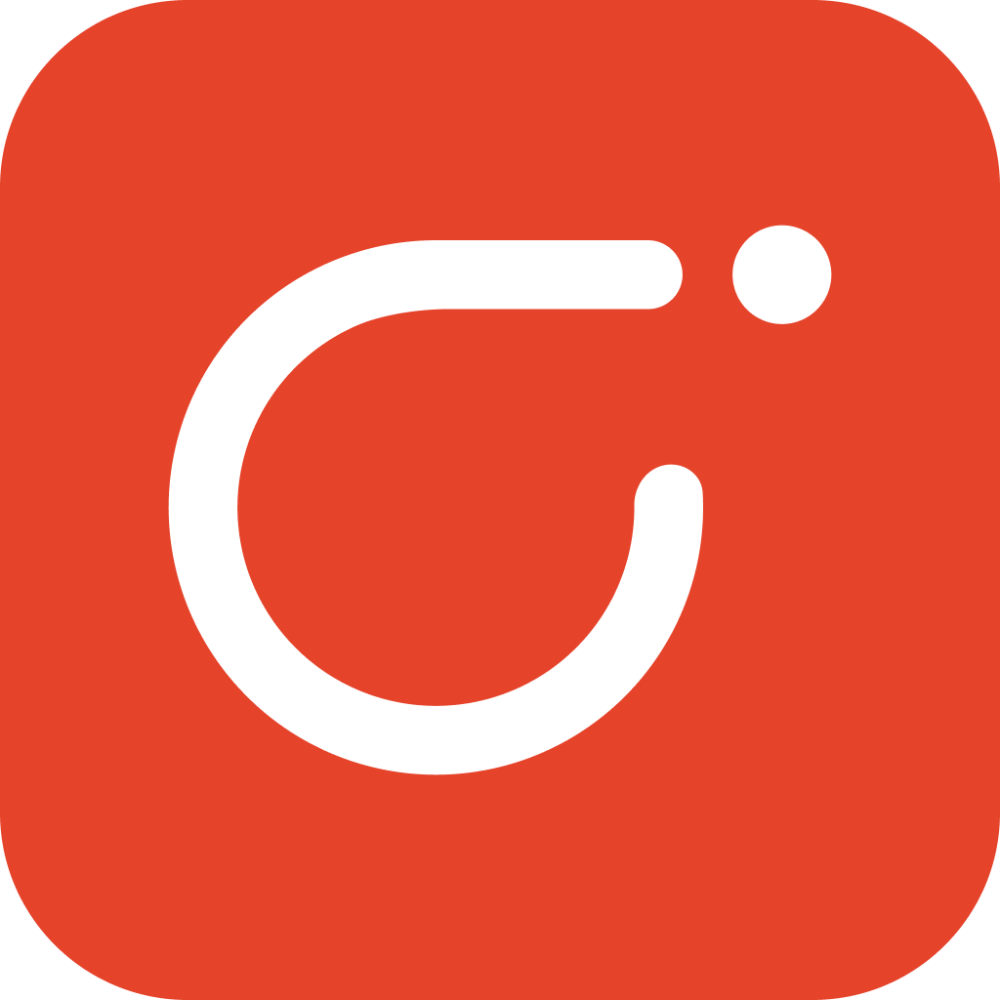
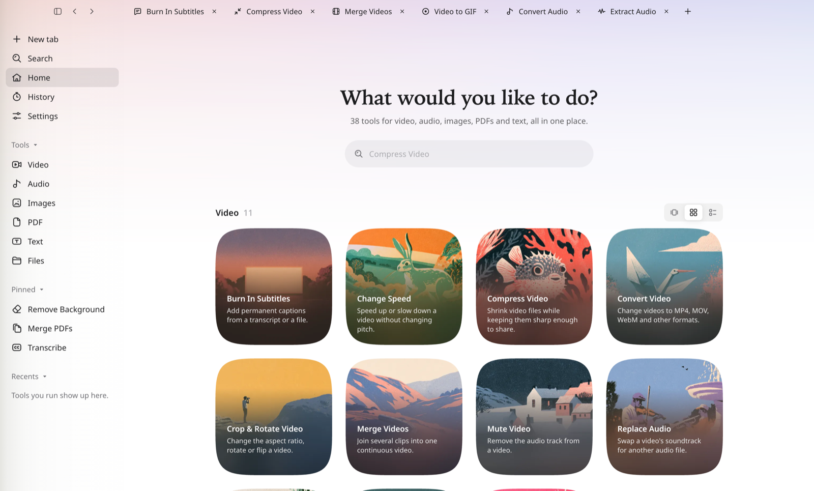

<p align="center">
  
</p>

<h1 align="center">Offlane</h1>

<p align="center">
  <strong>Everyday tools for video, audio, images, PDFs and text, in one desktop app that works on your own computer.</strong>
</p>

<p align="center">
  <a href="LICENSE"></a>
  
  
</p>

<p align="center">
  
</p>

Offlane brings nearly forty small tools together in one window: compress a video, turn part of it into a GIF, merge some PDFs, strip the location from a photo. Your files stay on your machine; nothing is uploaded to a server to be processed.

> **Early development.** There is no downloadable release yet. Compress Video works today; the other tools have their full interface but are still being connected. See [Tools](#tools).

## Key features

- **Works on your computer.** Files are processed locally, with no account and no uploads.
- **One window, many tools.** Video, audio, images, PDF, text and file tools, each with a short, focused page.
- **Tools chain together.** When a tool finishes, _What's Next?_ offers every tool that accepts its result, so compress → trim → GIF happens on one page.
- **Tabs and history.** Work in several tabs at once; History reopens any past session exactly as it was.
- **Toolkits on demand.** Heavier programs such as FFmpeg are downloaded only when a tool needs them, from builds published with their full source in [offlane-toolkits](https://github.com/vkhq/offlane-toolkits).
- **Free software.** Licensed under the GPL-3.0-or-later.

## Tools

| Group  | Tools                                                                                                                                                                                                           |
| ------ | --------------------------------------------------------------------------------------------------------------------------------------------------------------------------------------------------------------- |
| Video  | **Compress Video** ✓, Convert, Trim, **Resize Video** ✓, **Crop Video** ✓, **Rotate Video** ✓, **Change Aspect Ratio** ✓, **Change Speed** ✓, Merge, Mute, Replace Audio, Burn In Subtitles, **Video to GIF** ✓ |
| Audio  | **Convert** ✓, **Trim** ✓, **Clean Up** ✓, Record, **Extract Audio** ✓                                                                                                                                          |
| Images | Compress, Convert, Resize, Rotate, Remove Metadata, Remove Background                                                                                                                                           |
| PDF    | Merge, Split, Compress, Organize, Delete Pages, Extract Pages, PDF to Images, Images to PDF, Add Password, Remove Password, Sign                                                                                |
| Text   | Transcribe, Extract Text, Summarize, Translate                                                                                                                                                                  |
| Files  | Batch Rename                                                                                                                                                                                                    |

✓ = working now. The rest are coming.

## Build from source

You need [Node.js](https://nodejs.org) 22 or later, npm, and [gitleaks](https://github.com/gitleaks/gitleaks#installing) (used by the pre-commit check).

```sh
git clone https://github.com/vkhq/offlane-app.git
cd offlane-app
npm install
npm start
```

| Command                                     | What it does                                                                |
| ------------------------------------------- | --------------------------------------------------------------------------- |
| `npm start`                                 | Runs the app in development                                                 |
| `npm run package`                           | Builds the app for your platform into `out/`                                |
| `npm run make`                              | Builds installers (ZIP on macOS, Squirrel on Windows, deb and rpm on Linux) |
| `npm run typecheck` / `npm run lint`        | Checks types, lint and formatting                                           |
| `npm run test:integration`                  | Runs the integration tests                                                  |
| `npm run new-tool -- <group> <id> "<Name>"` | Starts a new tool (see [src/tools/README.md](src/tools/README.md))          |
| `npm run banners` / `npm run icons`         | Rebuilds the Home card images and the app icons                             |

A build you make yourself is not signed and has no auto-update. The tests are described in [src/tests/README.md](src/tests/README.md).

## Support

- **Bugs and ideas:** [GitHub Issues](https://github.com/vkhq/offlane-app/issues)
- **Email:** offlaneapp@gmail.com
- **Website:** [offlane.app](https://www.offlane.app)

## Contributing

Issues and discussion are welcome. Outside pull requests will need a signed Contributor License Agreement, which isn't published yet, so they can't be merged for now. See [CONTRIBUTING.md](CONTRIBUTING.md).

## Licence

Offlane's code is free software under the [GNU General Public License v3.0 or later](LICENSE). Toolkits carry their own licences, listed in each [offlane-toolkits release](https://github.com/vkhq/offlane-toolkits/releases).

The Offlane name, logo and app icons in [assets/brand/](assets/brand/) are not covered by the GPL: they are trademarks and all rights reserved. You're welcome to fork the code, but a fork must use its own name and icon. See [TRADEMARKS.md](TRADEMARKS.md) for what's allowed and what a fork must change.
